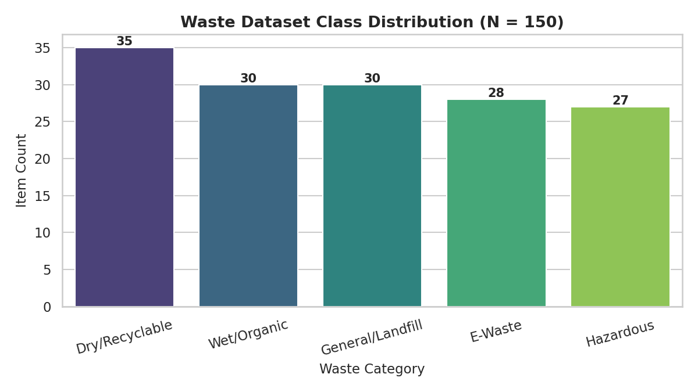
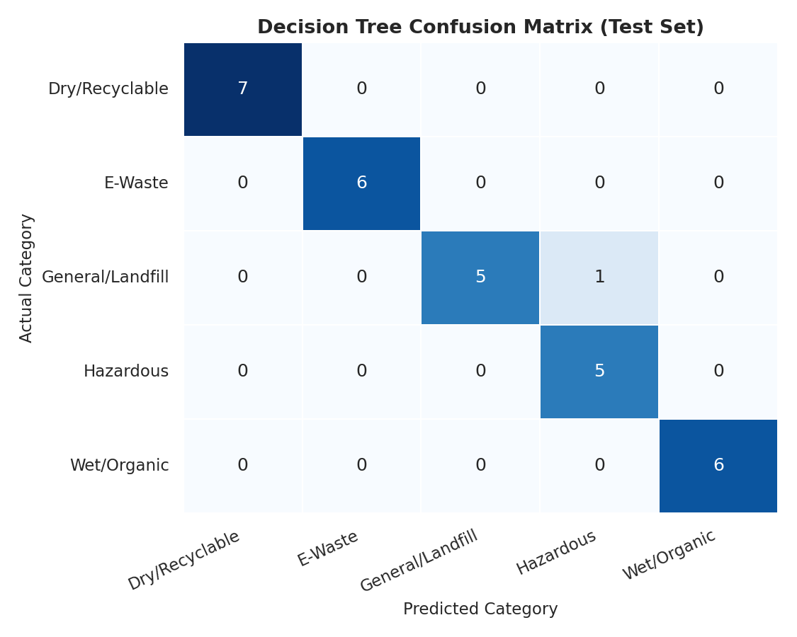
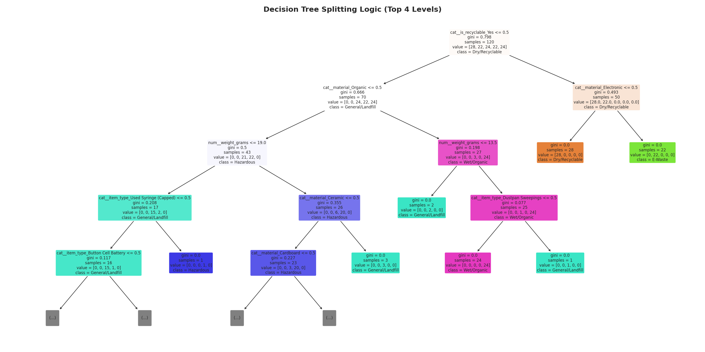

# ♻️ Smart Waste Category Classifier


| Student Name | Roll / ID | Batch | Academic Year | Project Domain |
| :--- | :--- | :--- | :--- | :--- |
| **Sheikh Kamran Yasir Hussain** | `123626` | `B1` | `2026` | AI / Machine Learning |

---

## 📌 Problem Statement
Improper waste segregation at the source is a major environmental challenge—people frequently place recyclable, organic, hazardous, and electronic waste into the wrong disposal bins. Mixing non-recyclables or hazardous materials contaminates recyclable batches and increases landfill load.

## 💡 Solution Overview
**Smart Waste Category Classifier** is an end-to-end Machine Learning application that predicts the exact waste bin category for everyday items based on four structured attributes (`item_type`, `material`, `weight_grams`, and `is_recyclable`).

Using a **Decision Tree Classifier** wrapped in a `scikit-learn` `ColumnTransformer` pipeline, the system provides:
- **High-Accuracy Classification** across 5 real-world disposal streams (`Dry/Recyclable`, `Wet/Organic`, `E-Waste`, `Hazardous`, `General/Landfill`).
- **Explainable AI Rules** (human-readable decision paths and tree diagrams).
- **Interactive Web App (`Streamlit`)** & **CLI Predictor** for real-time waste sorting recommendations.
- **Automated Evaluation & Unit Tests** (`unittest`) ensuring production-grade reliability.

---

## 📊 Dataset & Exploratory Insights
The curated dataset (`data/smart_waste_dataset.csv`) contains **150 balanced waste items** across 10 material types and 5 disposal categories:

| Feature | Data Type | Description & Examples |
| :--- | :--- | :--- |
| `item_type` | Categorical | Item name (e.g., `PET Water Bottle`, `Banana Peel`, `USB-C Charger`) |
| `material` | Categorical | `Plastic`, `Metal`, `Paper`, `Cardboard`, `Glass`, `Organic`, `Electronic`, `Chemical`, `Multi-layer Plastic`, `Ceramic` |
| `weight_grams` | Numerical | Item weight in grams (`1g` to `550g`) |
| `is_recyclable` | Categorical | Recyclability status (`Yes` / `No`) |
| `waste_category` | **Target** | `Dry/Recyclable`, `Wet/Organic`, `E-Waste`, `Hazardous`, `General/Landfill` |

<p align="center">
  
</p>

---

## 📈 Model Performance & Visual Diagnostics
- **Hold-Out Test Accuracy (80/20 Stratified Split):** `96.67%`
- **5-Fold Stratified Cross-Validation Accuracy:** `90.67% (±3.89%)`

### Confusion Matrix
<p align="center">
  
</p>

### Learned Decision Tree Rules
<p align="center">
  
</p>

---

## 📂 Repository Architecture
```text
smart-waste-category-classifier/
├── data/
│   └── smart_waste_dataset.csv             # 150-record tabular dataset
├── models/
│   └── waste_classifier_dt.pkl             # Serialized scikit-learn pipeline
├── notebooks/
│   └── Smart_Waste_Classifier_Analysis.ipynb # Step-by-step Jupyter Notebook
├── reports/
│   ├── figures/
│   │   ├── class_distribution.png          # Dataset balance chart
│   │   ├── confusion_matrix.png            # Model evaluation heatmap
│   │   └── decision_tree_diagram.png       # Visualized Decision Tree splits
│   ├── decision_tree_rules.txt             # Text export of if-else tree rules
│   └── evaluation_metrics.json             # Automated accuracy & CV metrics
├── src/
│   ├── train_model.py                      # End-to-end training & chart generator
│   ├── app.py                              # Interactive Streamlit Web UI
│   └── predict_cli.py                      # Interactive Command-Line tool
├── tests/
│   └── test_model.py                       # Automated unit test suite
├── requirements.txt                        # Project dependencies
├── .gitignore                              # Git ignore rules
└── README.md                               # Project documentation
```

---

## 🚀 Quickstart Guide

### 1. Clone & Install
```bash
git clone https://github.com/<your-username>/smart-waste-category-classifier.git
cd smart-waste-category-classifier
pip install -r requirements.txt
```

### 2. Launch the Interactive Web App (Recommended for Demo)
```bash
streamlit run src/app.py
```

### 3. Re-Train Model & Regenerate Plots
```bash
python src/train_model.py
```

### 4. Run Command-Line Predictor or Unit Tests
```bash
python src/predict_cli.py
python -m unittest discover -s tests
```

---

## 🎓 Key Takeaways & Future Scope
- **Why Decision Trees?** Decision Trees handle mixed categorical and numerical features cleanly without requiring feature scaling, and their transparent `if-else` logic makes waste sorting decisions easy to audit and explain.
- **Future Enhancements:** Integrate computer vision (`MobileNetV2` / `YOLOv8`) for camera-based waste detection alongside tabular metadata.
